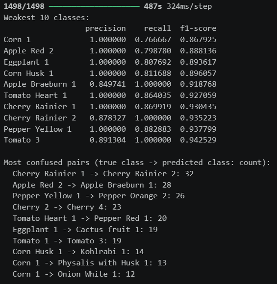

# Image Classification Using Pre-Trained CNNs

Dataset: Fruits 360.

## 1. Problem Statement and Research Objectives

As automation systems such as self-checkout and automatic stock tracking are commonplace, automatic recognition of fruit and vegetables can be useful for sorting, stock handling and checkout automation. I treated the Fruits 360 dataset as an image classification problem, where each image shows one fruit, vegetable, nut or mushroom variety on a white background. The version I used has 269 classes, and many classes have varieties of the same fruit (for example Apple Red 2 and Apple Braeburn 1).

The objectives were to:

1. Fine-tune a pre-trained convolutional neural network (CNN) to classify all 269 classes.
2. Measure how data augmentation, learning rate, dropout and the number of fine-tuned layers affect performance.
3. Compare two backbones, EfficientNetB0 and ResNet50.
4. Explain the model’s decisions with Grad-CAM and an error analysis.

One problem shaped the project: Fruits-360 is easy, and every configuration scored above 99% on validation images. Accuracy alone could not separate my experiments, so loss and accuracy were compared to deliberately altered test images.

## 2. Model Architecture and Design Decisions

**Transfer learning.** The goal of this project was to fine-tune a pretrained CNN model, either ResNet or EfficientNet as training 115,000 images from scratch would be slow and unnecessary.

**Why EfficientNetB0?** EfficientNetB0 is the main model used for fine-tuning. It balances network depth, width and input resolution, and reaches strong accuracy with roughly 4 million parameters, so it trains quickly. ResNet50, a well-known residual network with roughly 24 million parameters was also used to test whether a larger model would do better.

**Two-phase training.** First, I froze the pre-trained layers so they could not change and trained only the new classifier for three epochs. This stops the new, untrained layers from damaging what the network already knows. Then I unfroze the last 30 layers (60 in my final model) and trained for three more epochs with a much smaller learning rate (the size of each update), so the network was only adjusted slightly for fruit. I kept one type of layer, batch normalisation, frozen throughout, which is a common way to keep fine-tuning stable.

**Input.** The images are 100×100 pixels, so I enlarged them to 224×224, the size the pre-trained networks expect. ResNet50 also needs its own pixel scaling step, which I applied.

## 3. Data Preprocessing and Augmentation

**Dataset.** I used the 100×100 version of Fruits-360 from its GitHub page. The Training folder has 143,879 images and the Test folder has 47,931, covering 269 classes. Class sizes range from 144 images (Cabbage white 1) to 984 (Grape Blue 1), with an average of about 535, so the classes are slightly unbalanced. I did not resample, but I looked at results for each class so weak classes would show up.

**Splits.** I split the Training folder 80/20 using a fixed random seed, giving 115,104 training images and 28,775 validation images (used to check progress during training). The Test folder was kept for the final evaluation only. All experiments used the same copy of the dataset.

**Preprocessing.** I resized every image to 224×224. A few class folders are spelt differently in Training and Test (for example BlackBerry 4 and Blackberry 4), so I matched the names ignoring capital letters to keep the labels lined up. I also did not shuffle the test set, so predictions could be matched to the right labels in the error analysis.

**Augmentation.** Augmentation means randomly changing training images so the model sees more variety. I used a random horizontal flip, rotation and zoom on training images only. The aim was a model that copes with pictures that look different from the clean photos in the dataset.

**Robustness test.** Because accuracy on clean images was already so high, I also tested every model on altered test images: rotated, zoomed, and with brightness and contrast changed. Rotation and zoom overlap with the training augmentation, but brightness and contrast were never used in training. The changes are random, so differences of about one point between runs may just be noise.

\
&#91;Figure 1: sample training images.\]

## 4. Results and Performance Analysis

### 4.1 Training process and challenges

Each run used 3+3 epochs (three with the pre-trained layers frozen, three fine-tuning) and took about 150 minutes for EfficientNetB0 and 331 minutes for ResNet50. I changed one setting at a time so any difference could be put down to that setting, and recorded every run in a results table. I met four challenges:

- **Mismatched class names.** The Training and Test folders spelt some names differently, which caused errors when loading the data. I fixed this by matching names ignoring capital letters.
- **Different dataset copies.** The dataset on my PC and Google Colab had different numbers of classes (270 and 269). Results from different copies cannot be compared, so I ran every reported experiment on one copy.
- **Slow augmentation.** Runs using GPU acceleration on Colab on no augmentation parameters were fast, however when running with augmentation Colab reverted to CPU processing. Because the runs were so long Colab would time out and I was unable to finish the augmented runs. I performed the runs on my PC instead; it was a little slower however the reliability was more important.
- **Almost perfect accuracy.** Every run scored above 99% on validation images, so accuracy could not tell them apart. I added the altered-image test and compared loss, which separated the runs better.

### 4.2 Results

| Experiment | Test acc. | Test loss | Val. loss | Altered acc. | Minutes |
| --- | --- | --- | --- | --- | --- |
| EfficientNetB0, no augmentation | 0.9947 | 0.0225 | 0.0013 | 0.7383 | 159 |
| EfficientNetB0, augmentation | 0.9931 | 0.0276 | 0.0039 | 0.8379 | 157 |
| + learning rate 1e-4 | 0.9953 | 0.0186 | 0.0056 | 0.8225 | 149 |
| + dropout 0.5 | 0.9920 | 0.0304 | 0.0055 | 0.8368 | 148 |
| ResNet50, augmentation | 0.9939 | 0.0225 | 0.0033 | 0.7662 | 331 |
| EfficientNetB0, augmentation, 60 layers unfrozen | 0.9940 | 0.0235 | 0.0029 | 0.8411 | 150 |

*Table 1. Results for all runs (269 classes). Rows marked + change one setting from the augmented EfficientNetB0 baseline.*

**Accuracy is almost maxed out.** Test accuracy was between 0.9920 and 0.9953 for every run, a gap of about 160 test images. I ran each setting once, so differences this small do not prove anything.

**Validation looks better than it really is.** Loss is a score of how wrong the model’s predictions are, and lower is better. Validation loss (0.001–0.006) is much lower than test loss (0.019–0.030). Fruits-360 images are frames taken from videos of fruit rotating on a turntable, so validation images are almost copies of training images. The Test folder is therefore the fairer measure. Training accuracy was slightly below validation accuracy in every run, because dropout and augmentation only apply during training, so the model is not overfitting (memorising the training images).

**Augmentation made the biggest difference.** Augmentation raised accuracy on altered images from 0.738 to 0.838 (10 points) and lowered accuracy on clean test images by 0.16 points. Rotation and zoom were used in both the augmentation and the altered test, so part of this gain is the model having practiced those changes. It shows the model copes better with these changes.

**The other settings changed little.** A higher fine-tuning learning rate (1e-4) gave the best clean test accuracy and test loss, but worse validation loss and altered accuracy. Dropout of 0.5 gave no benefit: the model was not overfitting, so the extra dropout only slowed learning. Unfreezing 60 layers instead of 30 improved validation loss (0.0039 to 0.0029), test loss (0.0276 to 0.0235) and altered accuracy (0.8379 to 0.8411) without taking any longer.

**EfficientNetB0 beat ResNet50.** With the same settings, ResNet50 matched EfficientNetB0 on clean test accuracy (0.9939 against 0.9931) but scored 0.766 on altered images against 0.838, and took more than twice as long. I did not test why.

**Final model.** I chose EfficientNetB0 with augmentation and 60 unfrozen layers using validation loss and altered accuracy, not test accuracy, so the test set stayed a fair final check. It reached 99.40% test accuracy and 84.1% on altered images. 

\
&#91;Figure 2: training curves of the final model.\]

\
&#91;Figure 3: altered-image accuracy by experiment\]

## 5. Error Analysis and Potential Improvements

My final model got roughly 290 of the 47,931 test images wrong, and the mistakes were concentrated in a few classes. The weakest were Corn 1 (recall 0.77), Apple Red 2 (0.80), Eggplant 1 (0.81) and Corn Husk 1 (0.81). Recall is the share of a class’s images that the model found. Corn 1, Corn Husk 1 and Eggplant 1 are among the ten weakest classes in all six runs, so the cause is the data, not one unlucky training run. These classes have a precision of 1.0 but low recall: when the model predicts them it is right, but it misses many of their images.

The most common confusions fall into three groups:

- **Near-identical varieties:** Cherry Rainier 1 → Cherry Rainier 2 (32 images), Apple Red 2 → Apple Braeburn 1 (28), Cherry 2 → Cherry 4 (23) and Tomato 1 → Tomato 3 (19).
- **Similar colour across fruit:** Pepper Yellow 1 → Pepper Orange 2 (26) and Tomato Heart 1 → Pepper Red 1 (20).
- **Unusual views:** Eggplant 1 → Cactus fruit 1 (19), and the Corn and Corn Husk errors. 

\
&#91;Figure 4: error analysis final model.\]

Grad-CAM draws a heatmap showing which parts of an image most supported the model’s answer. For correct predictions, the heat sits mainly on the fruit and on distinctive parts. The stem of Pear 14 is the hottest region in all six runs, and the stem of Apple Granny Smith 1 is highlighted in every run where it was sampled. Stems stick out into the white background, so some heat outside the fruit is meaningful and not a fault. In the wrong predictions of the final model (Eggplant 1 → Beetroot 1, Cherry 2 → Cherry 4, Apple Red 2 → Apple Pink Lady 1, Corn Husk 1 → Physalis with Husk 1), the hot spots often lie on the outline or the background, not on the middle of the fruit where varieties differ in colour and texture. Eggplant 1 appears among the sampled errors of four runs with three different wrong labels (Beetroot 1, Dates 1, Cactus fruit 1), which suggests an unusual image with no single look-alike class. The heatmaps are coarse and cover only a few images, so I treat them as illustrations and not proof.

\
\
&#91;Figure 5: Grad-CAM for correct and wrong predictions of the final model
*Note: wrong images are incorrect and only noticed after the fact. The outcomes are correct however.\]

Possible improvements:

- Add more varied training images, especially cut or partial views of Corn, Corn Husk and Eggplant, and try the original-size images, which keep the fine detail that separates similar varieties.
- Give weak classes more weight during training, so mistakes on them count more.
- Add colour changes (brightness, contrast, hue) to the augmentation, since accuracy on altered images is only 84%.
- Train for longer with a learning rate that gradually decreases, since validation loss was still falling slowly, and repeat the runs with several random seeds to measure noise.
- Combine EfficientNetB0 and ResNet50 into an ensemble (averaging their predictions).

## 6. Conclusion and Future Work

I fine-tuned pre-trained CNNs on 269 Fruits-360 classes. My best model, EfficientNetB0 with augmentation and 60 fine-tuned layers, reached 99.40% test accuracy and 84.1% accuracy on altered images. Augmentation gave the biggest improvement, the other settings had small effects, and EfficientNetB0 matched ResNet50 on clean images while being more robust and twice as fast. The remaining errors come from near-identical varieties and unusual views.

The main limitations are that I ran each setting once, the validation images are almost copies of training images, and the altered-image test partly overlaps with the training augmentation. Future work should test on photographs with realistic backgrounds, since Fruits-360 images are taken against white backgrounds and my results may not carry over to them. I would also repeat the experiments with several random seeds, try the original-size images and compare ensembles.

## References

He, K., Zhang, X., Ren, S., & Sun, J. (2016). Deep residual learning for image recognition. In 2016 IEEE Conference on Computer Vision and Pattern Recognition (CVPR) IEEE. https://doi.org/10.1109/CVPR.2016.90

Oltean, M. (2017). Fruits-360 dataset [Data set]. GitHub. https://github.com/fruits-360

Selvaraju, R. R., Cogswell, M., Das, A., Vedantam, R., Parikh, D., & Batra, D. (2017). Grad-CAM: Visual explanations from deep networks via gradient-based localization. In 2017 IEEE International Conference on Computer Vision (ICCV). IEEE. https://doi.org/10.1109/ICCV.2017.74

Tan, M., & Le, Q. V. (2019). EfficientNet: Rethinking model scaling for convolutional neural networks. In K. Chaudhuri & R. Salakhutdinov (Eds.), Proceedings of the 36th International Conference on Machine Learning (Vol. 97). PMLR. https://proceedings.mlr.press/v97/tan19a.html

